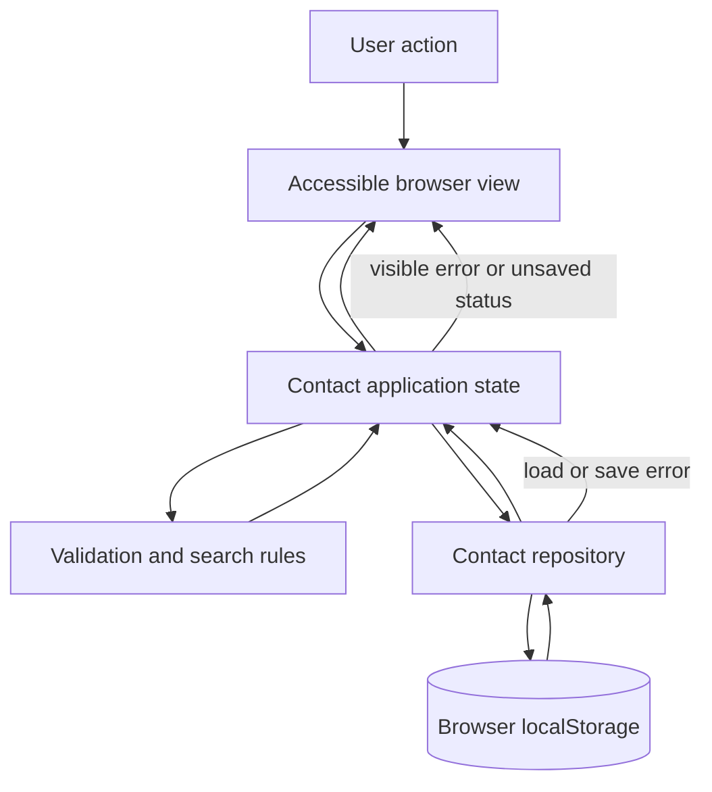

# Contact Management System Architecture Proposal

**Revision:** 5  
**Status:** Approved by the user on 2026-10-21 (revision 4); revision 5 approved by the user on 2026-10-30.  
**Basis:** `requirements.md` revision 3, explicitly approved by the user (FR-01 through FR-12, NFR-01 through NFR-03, and CS-01).  
**Approval history:** Architecture revision 3 was approved on 2026-10-21 under requirements revision 1. Architecture revision 4 was approved by the user on 2026-10-21 under requirements revision 2. Architecture revision 5 was approved by the user on 2026-10-30 under requirements revision 3, adding the local login gate (FR-12); it makes no other change to revision 4.

This document proposes an architecture for the browser-local Contact Management System. Technology and design choices below are proposals, not approved requirements. Existing repository and deployment records are not evidence that the implementation conforms to this proposal or to the revised browser scope.

## 1. Scope and Principles

The application is a client-side contact manager. Contact data is stored in the current browser's local storage, with no service or cross-device synchronization (FR-08). The architecture must preserve the required behavior for editing, searching, duplicate phone numbers, corrupt stored data, failed writes, keyboard operation, and responsive presentation (FR-01 through FR-11, NFR-01 through NFR-03).

Principles:

- Keep contact data and all contact operations in the browser; do not add a backend, analytics, or synchronization without new requirements. A single local login gate (FR-12) is approved as of revision 5; it adds no server, no multi-user account system, and no synchronization.
- Separate in-memory UI state from persistence so write failures do not erase visible user changes (FR-10).
- Identify contacts by an internal ID, never by phone number (FR-07).
- Validate stored data before it enters application state and preserve unreadable source data until the user authorizes replacement (FR-09).
- Prefer native browser semantics and a small dependency surface to support accessibility and reduce maintenance/security exposure (NFR-01 through NFR-03).

## 2. Proposed Components

| Component | Responsibility | Requirement trace |
|---|---|---|
| Contact view | Render the contact list, empty state, search results, and responsive layout. Keep list order independent of search-result filtering. | FR-03, FR-06, FR-11 |
| Contact form | Create and edit drafts; associate labels and validation feedback with fields; cancel without mutating saved data. | FR-01, FR-02, FR-04, NFR-02 |
| Delete confirmation | Identify the selected contact, require confirmation, and distinguish confirm from cancel. | FR-05, FR-07, NFR-01 |
| Contact application state | Own loaded contacts, query, form draft, selected ID, and persistence/error state. Apply create, edit, delete, and search operations by ID. | FR-01 through FR-07, FR-10 |
| Contact rules | Validate entered contacts and provide search comparison values. Keep display values distinct from comparison values. | FR-01, FR-02, FR-06, FR-07 |
| Storage adapter | Read/write the versioned contact document through `localStorage`; handle unavailable storage, parse/validation failures, and write exceptions without silently replacing source data. | FR-08 through FR-10 |
| Accessibility layer (view behavior) | Use semantic controls, visible focus, logical keyboard order, and accessible announcements for validation, search, storage, and save status. | NFR-01 through NFR-03 |
| Login gate | Set up the local username/passcode on first use, verify login against the salted hash stored in `localStorage`, hold a session-scoped authenticated flag, gate all contact rendering/operations behind it, and provide logout. Stores and compares only a salted hash, never a plaintext passcode. | FR-12, NFR-01, NFR-02 |

These are logical responsibilities, not a commitment to a particular component framework or visual design.

### 2.1 Login gate design (revision 5)

- **Credential storage:** a separate `localStorage` key (distinct from the contact-document key) holds `{ username, salt, passwordHash, hashAlgorithm }`. The passcode hash uses the Web Crypto `SubtleCrypto` digest API (e.g., SHA-256) over the passcode concatenated with a random per-setup salt; no plaintext passcode is ever written to storage, logs, or the DOM.
- **Session scope:** successful login sets an in-memory/`sessionStorage` authenticated flag for the current tab session only; it is not itself written to `localStorage`, so reopening the browser later requires logging in again (consistent with FR-08/FR-09 only applying to contact data, not to session authentication state).
- **Gating:** the contact view, form, delete confirmation, and search are not rendered/operable until the login gate reports authenticated; logout clears the session flag and returns to the login view without deleting the stored credential or any contact data.
- **Failure handling:** an incorrect username or passcode produces one generic, accessible error message; the system does not reveal which field was wrong (avoids a username-enumeration signal, though this is a convenience gate, not a security boundary — see Section 7).
- **No account recovery flow:** because there is no server to verify identity, a forgotten passcode has no reset-by-identity flow; the documented recovery is clearing this browser's local storage, which also removes stored contacts.

## 3. Proposed Technology Choices

| Choice | Proposal and rationale | Trace / caveat |
|---|---|---|
| Application runtime | A static, browser-only application with no application server. It directly matches the stated local-storage constraint and avoids introducing an unrequested data service. | FR-08; reconsider only with changed scope. |
| Language | TypeScript, compiled to browser JavaScript, to make contact records, storage outcomes, and UI state explicit and reduce accidental shape mismatches. | User selected this approach on 2026-10-21; supports FR-07 through FR-10. |
| UI approach | Native semantic HTML, CSS, and TypeScript without a UI framework initially. The specified workflows are limited enough that a framework would add dependency and build complexity without a demonstrated need. | User selected this approach on 2026-10-21; subject to approval of this revised architecture. |
| Build tooling | Vite for local development and reproducible static output. | User selected Vite on 2026-10-21; exact package versions remain for planning. |
| Persistence | Browser `localStorage`, behind a small adapter rather than accessed from view components. | Required by FR-08 and constrained by FR-09/FR-10. |
| Test tooling | A TypeScript unit-test runner plus browser-level tests; select exact tools during implementation planning based on the approved repository setup. | FR-01 through FR-11, NFR-01 through NFR-03. |
| Browser support | Current stable Chrome and Edge on Windows 11 desktop, with the exact browser versions and verification date recorded when tested. | CS-01. Previous major versions, Firefox, Safari, and mobile browsers have no support or compatibility claim. |

No existing dependencies are assumed. Exact package versions and test tools remain for planning; the architecture choices require approval before implementation.

## 4. Data Model and Interfaces

### Contact record

Proposed in-memory model:

```ts
type Contact = {
  id: string;
  name: string;
  phone: string;
  createdOrder: number;
};
```

`id` is unique and stable for the record's lifetime, and `createdOrder` supports newest-first ordering while preserving a contact's position on edit (FR-03, FR-04, FR-07). A monotonically increasing order value is a proposal; how ties or sequence exhaustion are handled is not a product requirement. The displayed `name` and `phone` should remain separate from any comparison-only search representation (FR-06). Phone input and search rules follow Section 6; name whitespace and tie ordering remain open (see Section 12).

### Stored document

Proposed serialized envelope:

```ts
type StoredContactsV1 = {
  schemaVersion: 1;
  contacts: Contact[];
  nextCreatedOrder: number;
};
```

The envelope enables validation and a future explicit migration path. The local-storage key should be namespaced to this application and documented in one storage module. Neither the key nor schema has been approved. On load, validate the envelope, every contact field, identifier uniqueness, order values, and relevant contact constraints before exposing records to the UI (FR-09). Unknown schema versions must be treated as unreadable, not silently rewritten.

### Internal interfaces

Representative boundaries (signatures are illustrative):

```ts
interface ContactRepository {
  load(): Promise<LoadResult>;
  save(document: StoredContactsV1): Promise<SaveResult>;
}

type LoadResult =
  | { kind: "loaded"; document: StoredContactsV1 }
  | { kind: "empty" }
  | { kind: "unreadable"; reason: string };

type SaveResult =
  | { kind: "saved" }
  | { kind: "failed"; reason: string };
```

The promise-based boundary allows UI code to handle outcomes uniformly, even though `localStorage` access is synchronous. Production storage failures must be converted to result values or handled errors; they must not be mistaken for successful writes. Recovery must retain the original raw value until explicit replacement is confirmed (FR-09). The concrete `reason` exposed to users should be safe and understandable, not a browser exception dump.

## 5. Data Flow



On startup, the repository reads and validates storage before the contact list is populated. A valid document is loaded into application state; missing data produces the empty state. Unreadable data enters a recovery/error state without an automatic write. Create, edit, and delete actions update an in-memory candidate state, validate it, and attempt persistence. The view reports success only after the write succeeds. If it fails, the candidate remains visible and the UI clearly indicates that it is unsaved (FR-10). Search is derived from in-memory contacts and does not write to storage (FR-06).

### Create, edit, and delete flow

```mermaid
sequenceDiagram
    actor User
    participant View
    participant State
    participant Rules
    participant Repo as ContactRepository
    participant Store as localStorage
    User->>View: Submit create or edit draft
    View->>State: Submit draft and target ID (if editing)
    State->>Rules: Validate draft
    Rules-->>State: Valid or field errors
    alt Invalid draft
        State-->>View: Keep draft and announce errors
    else Valid draft
        State->>Repo: Save candidate document
        Repo->>Store: setItem
        alt Write succeeds
            Store-->>Repo: Success
            Repo-->>State: Saved
            State-->>View: Show saved contact/status
        else Write fails
            Store-->>Repo: Exception
            Repo-->>State: Failed
            State-->>View: Keep visible change; mark unsaved
        end
    end
```

Deletion follows the same persistence boundary after confirmation. Cancellation performs no mutation. Edits replace data for the selected ID and preserve its order; deletion targets only that ID (FR-04, FR-05, FR-07).

## 6. Validation, Search, and Ordering

- Contact input validation enforces required name/phone and the explicitly specified phone constraints: after permitted formatting characters are removed, there must be 7–15 digits; letters and extensions are rejected (FR-01, FR-02). A plus sign is accepted only at the beginning; parentheses must be balanced; spaces and hyphens are permitted as separators. Preserve the entered phone string for display rather than applying canonical formatting, following the user's clarification on 2026-10-21.
- Keep the entered display string distinct from a derived search key. Phone search comparison ignores spaces, hyphens, and parentheses, and name search is case-insensitive (FR-06). Do not rewrite the displayed phone string.
- Search is a derived filter over all contacts and updates when the query changes; clearing the query restores the full ordered list (FR-06).
- Sort by creation order descending for list display. An edit does not change creation order. Distinct records may share a phone number and are selected by unique ID (FR-03, FR-04, FR-07).

## 7. Security and Privacy

The system stores personally identifying contact information in browser local storage. It is available to scripts running in the same origin and is not protected by server-side access control; users sharing a browser profile may also have access. Local storage is not an encrypted vault or a backup. The user selected clear disclosure of these facts on 2026-10-21. Do not claim encryption, secure deletion, backup, or regulatory compliance.

Revision 5 adds the FR-12 login gate at the user's explicit request on 2026-10-30. It stores only a salted hash of the local passcode and gates the UI behind a session-scoped authenticated flag (Section 2.1), but it is explicitly not a security boundary: anyone with access to the same browser profile's storage or developer tools can still read the stored hash and the contact data it gates, and offline guessing against the stored hash is not prevented. Do not claim this gate provides server-verified authentication, access control, or any compliance benefit.

Proposed safeguards:

- Keep contact data out of URLs, logs, telemetry, and error-reporting payloads. The passcode itself must never appear in logs, telemetry, error payloads, or the DOM outside its input field.
- Render contact-provided names and phone values as text, never as interpreted HTML.
- Avoid third-party scripts and unnecessary runtime dependencies; protect static hosting with HTTPS and a restrictive Content Security Policy where deployment permits.
- Do not include contact data in diagnostics. Show actionable, non-sensitive storage errors.
- Before the first contact is saved, show this notice in plain language: “Contacts are stored in this browser profile only. They are not encrypted, backed up, or synced. People sharing this browser profile and scripts running on this site may be able to access them.” Keep an accessible privacy link available afterward.
- On the login/setup screen, disclose in plain language that this login is a local convenience gate for this browser only, is not encrypted account security, and that clearing this browser's storage removes both the credential and all contacts.

These are architecture recommendations, not additional approved requirements. The user does not require legal review unless later determined applicable; no legal or regulatory compliance claim is made.

## 8. Error Handling and Recovery

| Condition | Proposed handling | Trace |
|---|---|---|
| Invalid form input | Keep the draft, identify invalid fields, and announce clear messages accessibly. | FR-01, FR-02, FR-04, NFR-02 |
| Empty list or no search matches | Render distinct helpful states; clearing search restores the full list. | FR-03, FR-06 |
| Storage unavailable or read throws | Do not claim data loaded or saved; show a persistent, accessible error state. Do not overwrite unknown data. | FR-08, FR-09 |
| Stored value malformed or unsupported | Attempt in-memory salvage without writing; never overwrite an occupied backup; verify the preserved raw value before confirmed replacement. On any backup or replacement failure, keep the original recoverable and show a blocking, actionable error. | FR-09 |
| Save throws or quota is exceeded | Keep current changes visible, mark them unsaved, offer Retry and Discard (which restores the last persisted document), and warn before navigation or refresh; never report success until persisted. | FR-10 |
| Cancel edit/delete | Discard only the relevant draft or pending action; leave saved contact data unchanged. | FR-04, FR-05 |

The storage adapter catches browser storage exceptions and returns explicit outcomes. The UI's visible unsaved state is distinct from persisted data; a failed write never counts as success, and pending changes may be lost if the user leaves despite the warning.

### Recovery proposal

On an unreadable document, preserve the exact raw value and show a blocking, accessible recovery state. Attempt to salvage individually valid contact records in memory without writing. Present the salvage count and require explicit confirmation before creating a recovered document. Before replacing the primary value, choose an unused namespaced backup key; never overwrite an occupied key. Write the exact original raw value, read it back, and compare it byte-for-byte. If no unused key can be written and verified, leave the primary value untouched and block recovery with an accessible error. After a verified backup, replace the primary value only with explicit confirmation. If that replacement fails, keep both copies, show a retryable error, and do not claim recovery succeeded. If no records can be salvaged, offer an empty replacement only after confirmation and successful backup verification. Never automatically reset or overwrite unknown data.

## 9. Repository Structure Proposal

The following is a suggested organization, not a description of existing files:

```text
src/
  app/             Application startup and state transitions
  contacts/        Contact types, validation, ordering, and search
  storage/         localStorage adapter, schema validation, recovery boundary
  ui/              Semantic views, form, confirmation, status announcements
  styles/          Responsive layout, focus, and interaction styling
tests/
  unit/            Contact rules and schema validation
  integration/     State and repository behavior
  browser/         End-to-end workflows and responsive/accessibility checks
index.html
```

Avoid adding server, synchronization, import/export, or duplicate-detection modules unless requirements change. A `src/auth/` module (credential setup, hashing, login/logout, session flag) is approved as of revision 5 (FR-12); it remains local-only and introduces no server or multi-user account system.

## 10. Test Strategy

1. **Unit tests:** Required-field and phone validation boundaries, including leading-plus and balanced-parentheses rules; permitted separators; duplicate-phone records; stable IDs/order; case-insensitive name search; formatted phone search; edit preserving order; storage schema and identifier validation (FR-01 through FR-07, FR-09).
2. **Repository tests:** Empty load, valid load, malformed and unsupported documents, duplicate IDs, storage read exceptions, backup-key collision, backup-write/read-back/mismatch failures, salvage outcomes, confirmation-gated replacement, and primary-write failure. Assert the exact original raw value remains recoverable and no recovery success is reported on every failure path (FR-08 through FR-10).
3. **State/integration tests:** Create, edit, cancel, confirm/cancel delete, duplicate phone contacts, newest-first ordering, search updates, empty states, Retry and Discard after failed writes, and warnings before navigation or refresh with unsaved changes (FR-01 through FR-10).
4. **Browser and viewport matrix:**

  | Target or check | Verification scope | Claim boundary |
  |---|---|---|
  | Current stable Chrome on Windows 11 desktop | Run the supported browser workflow and regression suite; record the exact browser version, Windows version, and date. | Supported target under CS-01 only when verified. |
  | Current stable Edge on Windows 11 desktop | Run the supported browser workflow and regression suite; record the exact browser version, Windows version, and date. | Supported target under CS-01 only when verified. |
  | 320 CSS-pixel viewport | Check responsive layout and unintended horizontal scrolling, using a supported desktop browser and a narrow/emulated viewport as appropriate. | Verifies FR-11 layout behavior only; viewport emulation or width checks do not certify mobile browsers. |
  | Previous browser majors, Firefox, Safari, and mobile browsers | Not required targets in this scope. | No support or compatibility claim; do not report them as verified. |

  Browser-test automation and a narrow viewport do not expand CS-01. Record actual target versions and outcomes; do not infer compatibility for untested targets.
5. **Accessibility verification:** Complete automated accessibility checks and manual keyboard and screen-reader assessment before any WCAG 2.2 AA claim (NFR-03). G-01 remains a separate manual gate in the SDLC; it is not replaced by browser automation, viewport checks, or this architecture proposal.

No tests were run as part of this architecture revision. Exact test tools and versions remain to be selected during planning. The matrix above defines target scope, not completed verification.

## 11. Deployment and Configuration

The proposed application remains static assets served over HTTPS, with no application server, API, database, account configuration, or secret required. Hosting must serve the app's entry document for its route (a single route is currently proposed). The output can be deployed without transferring contact records; the records remain in each browser's local storage.

Cloudflare Pages is an existing deployment record and remains live according to the SDLC status. That record and prior deployment checks are not verification of release readiness under requirements revision 2 or CS-01. This architecture revision authorizes no new deployment action and does not newly select or change a hosting provider. Any release under the revised scope requires the intervening approvals and recorded verification on current stable Chrome and Edge on Windows 11 desktop; it must not claim support for excluded targets. A 320 CSS-pixel layout check remains an FR-11 requirement and does not establish mobile-browser compatibility.

Configuration should be build/deployment-level only: static asset base path, security headers/CSP, and optional non-sensitive application metadata. Do not put secrets or contact data in build-time environment variables. Confirm CSP compatibility and supported storage behavior before release, and record browser versions and outcomes for each CS-01 target.

## 12. Open Decisions

These points are deliberately not treated as approved requirements:

1. **Privacy notice:** The user selected the notice text and presentation before first save with a persistent accessible link; revision 3 incorporated it. This proposal carries it forward.
2. **Technology and test tooling:** TypeScript, Vite, and native HTML/CSS/TypeScript remain the selected approach. Exact package versions, test tools, and browser automation setup remain for planning.
3. **Deployment:** Generic HTTPS static hosting remains the selected direction. Cloudflare Pages is an existing deployment record, not a new deployment authorization in this revision. Confirm base-path and security-header constraints during planning.
4. **Contact display and ties:** Name whitespace/casing behavior and deterministic ordering for contacts created at the same time remain unspecified.

CS-01 resolves the supported-browser scope; it is not an open compatibility decision. Actual current-stable versions and test outcomes must be established at verification time and are not established by this proposal.

## 13. Traceability Summary

| Architecture area | Requirement IDs |
|---|---|
| Contact model, create/edit/delete, identity, ordering | FR-01, FR-03, FR-04, FR-05, FR-07 |
| Phone validation and search | FR-02, FR-06 |
| Storage, recovery, and persistence errors | FR-08, FR-09, FR-10 |
| Responsive layout at 320 CSS pixels | FR-11; viewport/layout testing does not certify mobile-browser compatibility |
| Keyboard operation, assistive-technology feedback, and conformance assessment | NFR-01, NFR-02, NFR-03; G-01 remains a separate manual gate |
| Supported browser target and excluded compatibility claims | CS-01 |
| Privacy/security recommendations | FR-08, FR-09; requirements Section 6 (considerations, not additional controls) |

## 14. Limitations

Architecture revision 4 was approved by the user on 2026-10-21 under requirements revision 2. Historical browser and deployment checks remain limited to their recorded targets and do not establish verification for untested targets. This document does not inspect or validate implementation code, select final package versions, establish legal/privacy compliance, or authorize a new deployment. No product code was changed and no tests were run as part of revision 4.

Architecture revision 5 was approved by the user on 2026-10-30 under requirements revision 3, adding the local login gate design (Section 2.1) and its security disclosure (Section 7) for FR-12. It makes no other change to revision 4's scope, components, or claims, and authorizes no deployment.